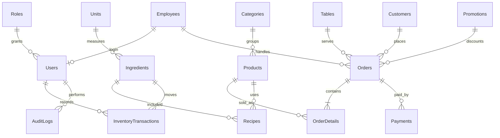

# Database design

Database name: `CoffeeManagementDB` (SQL Server 2022).

The `Orders` row is the bill header; `OrderDetails` stores a snapshot of each item's name and unit price so later catalog changes do not alter historical bills. Payments are append-only records and may be split across methods. `sp_Payment_Collect` locks the bill and inserts a payment plus updates its paid state in one SQL transaction. Every persisted date uses `datetime2`; all money uses `decimal(18,2)`. Inventory quantity is stored as `decimal(18,3)` and on-hand quantity is derived from transaction history.

Scripts are intended to be run in this order from SQL Server Management Studio or `sqlcmd`: `CreateDatabase.sql`, `Tables.sql`, `Constraints.sql`, `Indexes.sql`, `Views.sql`, `StoredProcedures.sql`, `SeedData.sql`, `AuditTriggers.sql`. `CreateDatabase.sql` targets a local SQL Server instance and creates the database if absent. No database server was available during authoring, so these scripts have not been executed against SQL Server in this environment.
